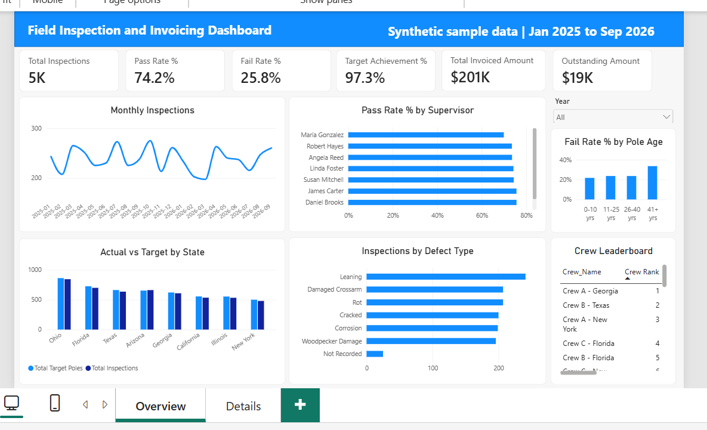
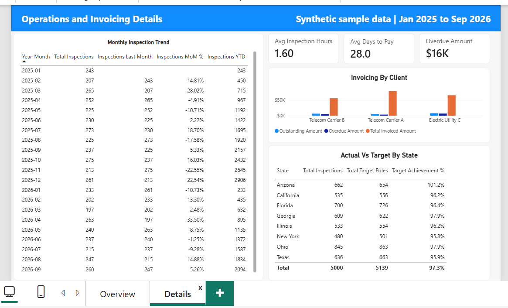
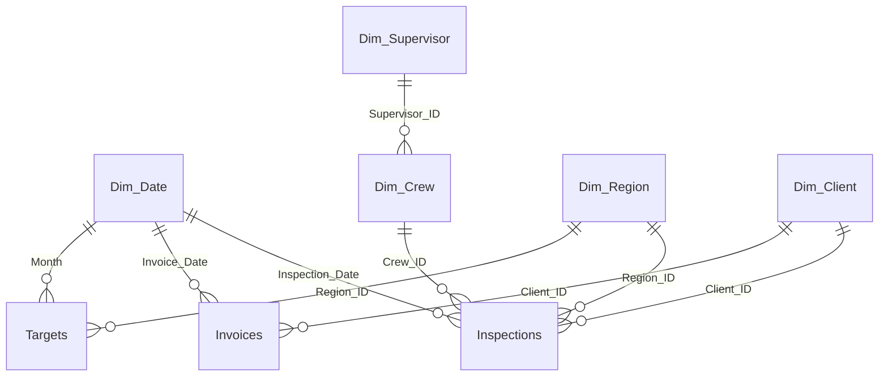

# Field Inspection and Invoicing Dashboard (Power BI)

An end-to-end Power BI project that turns raw pole-inspection and invoicing data into a decision-ready dashboard for telecom and utility field operations.

> **Data note:** all data in this repository is **synthetic**. Names, regions, rates and numbers are made up for practice. No real client or employer data is used.





---

## Business questions

| # | Question | Where it is answered |
|---|---|---|
| 1 | How many poles were inspected, and what is the pass rate? | Overview: KPI cards, Monthly Inspections |
| 2 | Which crews and supervisors perform best? | Overview: Pass Rate % by Supervisor, Crew Leaderboard |
| 3 | Are we meeting our monthly targets by region? | Overview: Actual vs Target by State |
| 4 | How much have we invoiced, and how much is still unpaid? | Details: Invoicing by Client, Avg Days to Pay, Overdue Amount |
| 5 | What are the most common defects, and do older poles fail more? | Overview: Inspections by Defect Type, Fail Rate % by Pole Age |

## Tools and skills demonstrated

- **Power Query:** data cleaning and transformation (ETL)
- **Data modeling:** star schema, relationships, shared dimension tables, a custom date table
- **DAX:** 15 measures, calculated columns, time intelligence, ranking, iterators
- **Power BI:** KPI cards, charts, slicers, cross-filtering, a 2-page report layout
- **Testing:** reconciliation checks against the source data
- **Excel:** source data

## Data model



- **3 fact tables:** Inspections, Invoices, Targets
- **5 dimension tables:** Dim_Crew, Dim_Supervisor, Dim_Region, Dim_Client, Dim_Date
- **9 relationships**, all many-to-one with single-direction filtering
- Invoices connect to Client and Date only, so state filters do not affect the invoicing cards (by design)

## Data cleaning (Power Query)

| Issue found | Fix |
|---|---|
| 45 duplicate rows (same Inspection_ID) | Removed, 5,045 rows to 5,000 |
| Inspection_Status in mixed case with extra spaces | Trimmed and capitalized each word |
| 20 blank Inspection_Status | Labeled `Unknown` (rows kept) |
| Blank Defect_Type | `Not Recorded` for Fail or Needs Repair rows, `No Defect` otherwise |
| 8 impossible Inspection_Hours (0 and 36 to 60 hours) | Set to blank in a new `Hours_Clean` column so averages ignore them |
| Wrong data types (dates stored as date-time, custom columns as Any) | Set to Date, Decimal Number, Text |
| Lookup tables loaded without headers | Promoted the first row to headers |

## Key measures

| Measure | Result (all data) |
|---|---|
| Total Inspections | 5,000 |
| Pass Rate % (completed inspections) | 74.2% |
| Fail Rate % | 25.8% |
| Target Achievement % | 97.3% |
| Total Invoiced Amount | $200,918 |
| Outstanding Amount | $19,361 |
| Overdue Amount | $15,611 |
| Avg Days to Pay | 28.0 days |
| Avg Inspection Hours | 1.6 hours |

All 15 measures with explanations are in [docs/DAX_MEASURES.md](docs/DAX_MEASURES.md). Table and column definitions are in [docs/DATA_DICTIONARY.md](docs/DATA_DICTIONARY.md).

## What the data shows

- **Pole age matters.** Poles aged 41+ years fail 33.6% of the time, against 21.7% to 23.6% for younger poles.
- **Crew performance varies widely.** Pass rate ranges from 87.9% (best crew) to 67.3% (lowest crew).
- **Targets are mostly met.** Overall achievement is 97.3%, and only one state (Arizona) beat its target.
- **Clients pay slightly early on average** (28.0 days against 30-day terms), but Electric Utility C has the highest overdue amount ($6,815).

## Testing

Every KPI was checked against an independent calculation from the source data:

1. Inspections by state add up to 5,000 (no unassigned rows).
2. Targets by state add up to 5,139, and achievement reconciles to 97.3%.
3. The Year slicer changes every card, and 2025 plus 2026 add up to the totals.
4. Cross-filtering from a state selection updates the inspection visuals, and the invoicing cards stay unchanged, as designed.

## How to open the report

1. Install **Power BI Desktop** (free).
2. Download `powerbi/Field_Operations.pbix` and `data/Field_Operations_Practice_Data.xlsx`.
3. Open the .pbix file. If Power BI cannot find the data, go to **Home → Transform data → Data source settings → Change source**, and point it to your copy of the Excel file.

## Repository structure

```
Field-Inspection-Dashboard/
├── README.md
├── data/
│   └── Field_Operations_Practice_Data.xlsx
├── powerbi/
│   └── Field_Operations.pbix
├── images/
│   ├── overview.png
│   └── details.png
└── docs/
    ├── DATA_DICTIONARY.md
    └── DAX_MEASURES.md
```

## Limitations

- The data is synthetic, so the patterns (for example, older poles failing more) are built in for demonstration.
- Pass Rate % and Fail Rate % use completed inspections only. Pending and Unknown statuses are excluded.
- Invoices are not linked to State, so the invoicing cards ignore a state selection.

## Author

**Nandha Kumar B**, Data Analyst (telecom and utilities)
[LinkedIn](https://www.linkedin.com/in/nandha-kumar-banuraj/)
